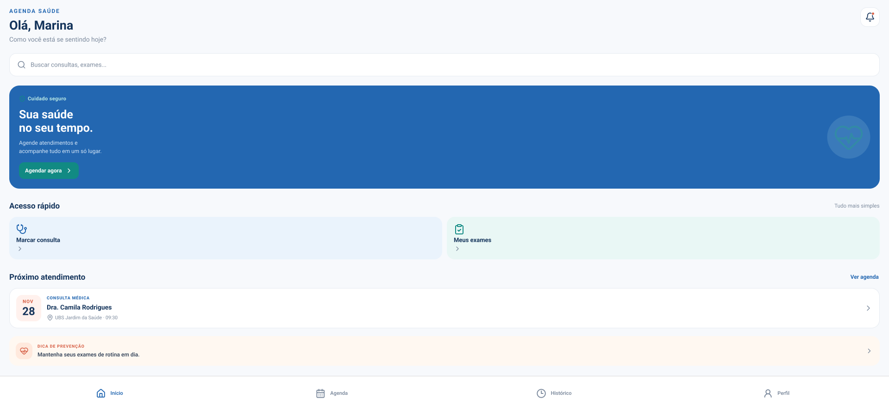
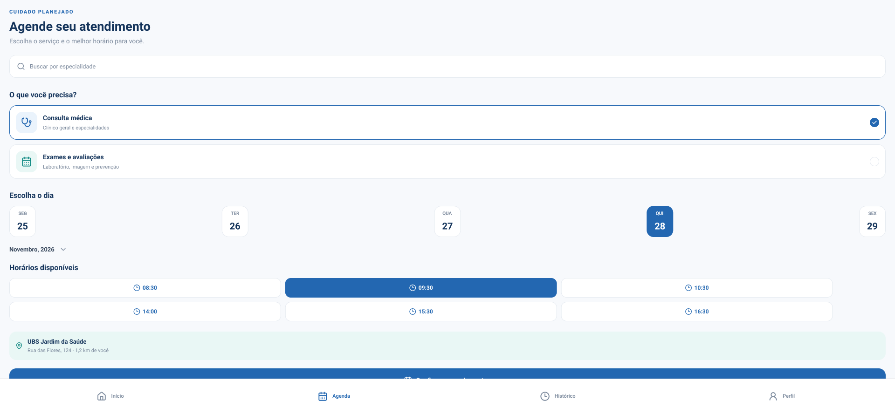
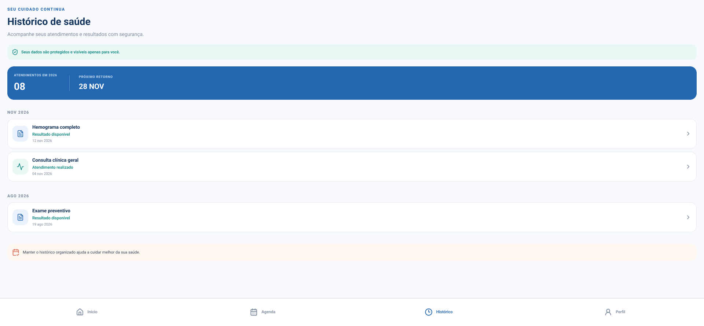
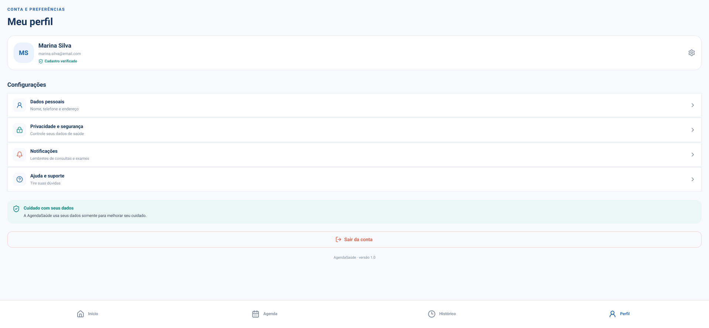
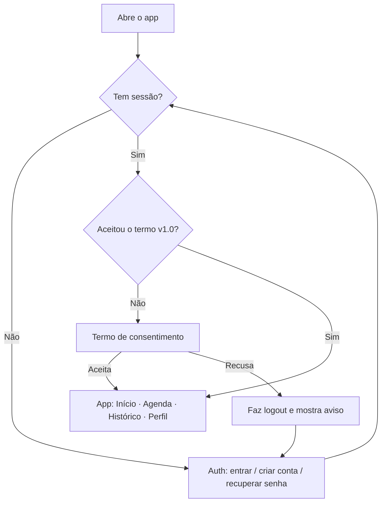

# AgendaSaúde

App público de saúde para **agendar consultas**, **acompanhar o histórico médico** e **apoiar a prevenção**, com foco em **acessibilidade** e **proteção de dados (LGPD)**.

> Trabalho de Conclusão de Curso (TCC) — Desenvolvimento de Sistemas, SENAI.
> Squad **Bando de Loucos**.

🔗 **Demo:** https://agenda-saude-eta.vercel.app

---

## Sumário

- [Telas](#telas)
- [Funcionalidades](#funcionalidades)
- [Fluxo do app](#fluxo-do-app)
- [Tecnologias](#tecnologias)
- [Estrutura do projeto](#estrutura-do-projeto)
- [Como rodar localmente](#como-rodar-localmente)
- [Banco de dados](#banco-de-dados)
- [Deploy na Vercel](#deploy-na-vercel)
- [Segurança e LGPD](#segurança-e-lgpd)
- [Problemas comuns](#problemas-comuns)
- [Roadmap](#roadmap)

---

## Telas

> As imagens abaixo mostram o **layout de interface** do AgendaSaúde (com dados de exemplo). Veja em [Funcionalidades](#funcionalidades) o que já está implementado e o que está planejado.

### Início
Saudação personalizada, busca, banner de chamada para agendar, acesso rápido (marcar consulta e meus exames), próximo atendimento e dica de prevenção.



### Agenda
Escolha do tipo de atendimento (consulta médica ou exames), do dia, do horário disponível e da unidade de saúde mais próxima.



### Histórico de saúde
Linha do tempo de atendimentos e resultados de exames, agrupada por mês, com aviso de que os dados são visíveis apenas para o próprio usuário.



### Perfil
Dados da conta, configurações (dados pessoais, privacidade, notificações, ajuda) e botão para sair.



---

## Funcionalidades

**Já implementadas (Sprint 1):**

- ✅ **Cadastro** com nome, CPF, data de nascimento, telefone, e-mail e senha
  - Máscara de CPF (`000.000.000-00`) e **validação dos dígitos verificadores**
  - Senha com no mínimo 8 caracteres
- ✅ **Login** por e-mail e senha
- ✅ **Aviso de CPF já cadastrado**, com atalho para recuperação de senha
- ✅ **Recuperação de senha** (envio do link por e-mail)
- ✅ **Termo de consentimento LGPD**: o uso do app só é liberado após o aceite, que é **registrado no banco** com a versão do termo e a data/hora
- ✅ **Estrutura de navegação** com as quatro abas: Início, Agenda, Histórico e Perfil
- ✅ Tela de Início com saudação pelo nome do usuário e atalhos
- ✅ Tela de Perfil com nome, e-mail, avatar com iniciais e botão **Sair da conta**
- ✅ Foco visível (`:focus-visible`), `role="alert"` nas mensagens de erro e campos com `autocomplete` adequados (acessibilidade)

**Planejadas (próximas sprints):**

- ⏳ Agendamento real: especialidade, dia, horário e unidade (a aba Agenda mostra um aviso "em breve")
- ⏳ Histórico real de consultas, exames e vacinas (a aba Histórico mostra o estado vazio)
- ⏳ Próximo atendimento na tela Início, lembretes e notificações
- ⏳ Edição de dados pessoais e configurações de privacidade

---

## Fluxo do app



---

## Tecnologias

| Camada | Tecnologia |
| --- | --- |
| Front-end | [React 18](https://react.dev) + [Vite 5](https://vitejs.dev) |
| Ícones | [lucide-react](https://lucide.dev) |
| Back-end e banco | [Supabase](https://supabase.com) (Auth + Postgres com Row Level Security) |
| Deploy | [Vercel](https://vercel.com) |

---

## Estrutura do projeto

```
AgendaSaude/
├── docs/
│   └── screenshots/        # Imagens usadas neste README
├── src/
│   ├── main.jsx            # Ponto de entrada do React
│   ├── App.jsx             # Controla sessão e consentimento, decide qual tela mostrar
│   ├── Auth.jsx            # Login, cadastro e recuperação de senha
│   ├── Termo.jsx           # Termo de consentimento LGPD
│   ├── Shell.jsx           # Navegação por abas (Início, Agenda, Histórico, Perfil)
│   ├── supabase.js         # Cliente do Supabase (lê as variáveis de ambiente)
│   └── styles.css          # Estilos globais
├── supabase/
│   └── schema.sql          # Tabelas, políticas RLS, trigger e função do banco
├── index.html
├── vite.config.js
├── package.json
├── .env.example            # Modelo das variáveis de ambiente
└── .gitignore
```

---

## Como rodar localmente

**Pré-requisitos:** [Node.js](https://nodejs.org) 18 ou superior e uma conta gratuita no [Supabase](https://supabase.com).

### 1. Clone e instale

```bash
git clone https://github.com/guiconst/AgendaSaude.git
cd AgendaSaude
npm install
```

### 2. Configure o Supabase

1. Crie um projeto no Supabase.
2. Em **SQL Editor**, cole e execute o conteúdo de [`supabase/schema.sql`](supabase/schema.sql).
3. Em **Authentication → Providers → Email**, desative **Confirm email** (assim o usuário entra direto após o cadastro).
4. Em **Authentication → URL Configuration**, ajuste o **Site URL**:
   - local: `http://localhost:5173`
   - produção: a URL da Vercel (usada nos links do e-mail de recuperação de senha)

### 3. Configure as variáveis de ambiente

```bash
cp .env.example .env
```

Preencha o `.env` com os valores de **Supabase → Project Settings → API**:

```env
VITE_SUPABASE_URL=https://SEU-PROJETO.supabase.co
VITE_SUPABASE_ANON_KEY=sua-chave-anon-public
```

> ⚠️ **Nunca suba o `.env` para o GitHub** (ele já está no `.gitignore`) e **nunca use a chave `service_role` no front-end**. Use somente a chave `anon`.

### 4. Rode

```bash
npm run dev
```

Acesse http://localhost:5173.

### Scripts disponíveis

| Comando | O que faz |
| --- | --- |
| `npm run dev` | Servidor de desenvolvimento com hot reload |
| `npm run build` | Gera a versão de produção na pasta `dist/` |
| `npm run preview` | Serve localmente a versão gerada pelo build |

---

## Banco de dados

O arquivo [`supabase/schema.sql`](supabase/schema.sql) cria:

| Item | Descrição |
| --- | --- |
| `profiles` | Dados do usuário: nome, CPF (único), data de nascimento e telefone. Ligada a `auth.users`. |
| `consentimentos` | Registro de cada aceite do termo LGPD: usuário, versão do termo e data/hora. |
| Políticas RLS | Cada usuário só consegue **ler o próprio perfil** e **ler/registrar os próprios consentimentos**. |
| Trigger `on_auth_user_created` | Cria automaticamente o perfil quando uma conta é criada, usando os dados enviados no cadastro. |
| Função `cpf_existe(c)` | Retorna apenas `true`/`false` para avisar que o CPF já tem conta, sem expor dados. |

---

## Deploy na Vercel

1. Importe o repositório na [Vercel](https://vercel.com/new). O preset **Vite** é detectado automaticamente (build `npm run build`, saída `dist`).
2. Em **Settings → Environment Variables**, cadastre para Production, Preview e Development:
   - `VITE_SUPABASE_URL`
   - `VITE_SUPABASE_ANON_KEY`
3. Faça o deploy (ou **Redeploy**, se as variáveis foram criadas depois).

> As variáveis `VITE_*` são embutidas **no momento do build**. Se você alterá-las, é preciso fazer um novo deploy.

---

## Segurança e LGPD

- Dados de saúde são **dados sensíveis** pela LGPD. O app exige **consentimento explícito** antes do uso e registra o aceite no banco, com a versão do termo (`VERSAO_TERMO` em `src/Termo.jsx`).
- Quem **não aceita** o termo é desconectado e não acessa o app.
- O **Row Level Security** do Postgres garante que um usuário nunca leia dados de outro.
- O CPF é salvo apenas com dígitos e é único por conta.
- A chave `anon` do Supabase é pública por natureza; a proteção dos dados vem das políticas RLS, não do sigilo dessa chave.

**Pontos de atenção conhecidos:**

- A função `cpf_existe` pode ser chamada sem login, o que permite descobrir se um CPF já tem conta. É um compromisso consciente para dar o aviso de "CPF já cadastrado"; em produção, considere limitar a taxa de chamadas.
- O e-mail de recuperação de senha é enviado, mas a tela para **definir a nova senha** após clicar no link ainda não foi implementada.

---

## Problemas comuns

| Sintoma | Causa provável | Solução |
| --- | --- | --- |
| **Tela branca** no site publicado | Variáveis `VITE_SUPABASE_*` não cadastradas na Vercel (o app quebra com `supabaseUrl is required`) | Cadastre as variáveis e faça **Redeploy** |
| Tela branca local | Falta o arquivo `.env` | `cp .env.example .env` e preencha |
| `npm ci` falha com "lock file out of sync" | `package.json` e `package-lock.json` com versões diferentes (ex.: Vite) | Rode `npm install` e commit dos dois arquivos |
| Cadastro funciona, mas pede confirmação de e-mail | **Confirm email** está ativado no Supabase | Desative em Authentication → Providers → Email |
| Erro ao cadastrar / `cpf_existe` não existe | `schema.sql` não foi executado | Rode o arquivo no SQL Editor do Supabase |
| Link de recuperação abre `localhost` | **Site URL** do Supabase incorreto | Ajuste em Authentication → URL Configuration |

---

## Roadmap

- [x] **Sprint 1** — Cadastro, login, termo LGPD e estrutura de telas
- [ ] **Sprint 2** — Agendamento de consultas e exames (especialidade, dia, horário, unidade)
- [ ] **Sprint 3** — Histórico de saúde e resultados de exames
- [ ] **Sprint 4** — Notificações, lembretes e dicas de prevenção
- [ ] Tela de nova senha, edição de dados pessoais e configurações de privacidade

---

## Equipe

Squad **Bando de Loucos** — TCC de Desenvolvimento de Sistemas, SENAI.
